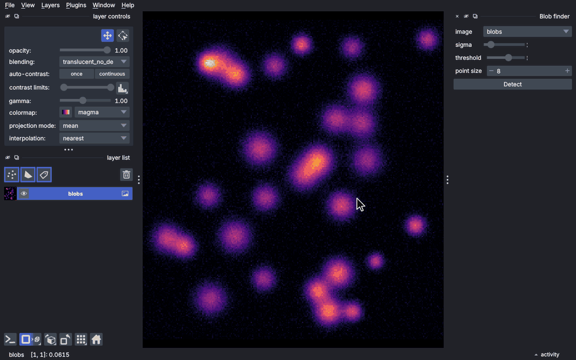

# napari-demo-recorder

[](https://github.com/bauerdavid/napari-demo-recorder/raw/main/LICENSE)
[](https://github.com/bauerdavid/napari-demo-recorder/actions)
[](https://napari-hub.org/plugins/napari-demo-recorder)

**Scripted, re-renderable demo GIFs for napari plugins (and any Qt app), for READMEs and tutorials.**

A demo is a short YAML file. Rendering it starts napari, drives the real UI (cursor moves, clicks,
slider drags, key presses, canvas strokes), draws cursor, click, key and caption overlays, and writes an
optimised GIF. When your UI changes, re-render and the GIF is current again. This works locally
or headless in CI.

<!-- demo:showcase -->

<!-- /demo:showcase -->

*The GIF above is rendered by this plugin from [`examples/showcase.demo.yaml`](examples/showcase.demo.yaml).*

## Why

| | screenshots | napari-animation | screen recorders | **napari-demo-recorder** |
|---|---|---|---|---|
| shows UI interaction (clicks, docks, typing) | no | no (camera/layer keyframes) | yes | **yes** |
| re-render when the UI changes | n/a | yes | no, record again by hand | **yes** |
| headless / CI | yes | yes | no | **yes** (Xvfb) |
| cursor & key overlays | no | no | some | **yes** |
| fits GitHub's GIF size limit automatically | n/a | no | no | **yes** |

## Install

```bash
pip install napari-demo-recorder        # optional: [mp4] for MP4 output
```

## A demo file

```yaml
demo: 1
app: napari
window: {size: [1280, 800]}
output: {path: docs/annotate.gif, fps: 12, scale: 0.75, max_size: 5MB}
setup:                                   # runs before recording starts
  - open_sample: [napari, cells3d]
  - open_plugin: [my-plugin, My Widget]
steps:
  - caption: "1. Pick a tool"
  - click: {button: Create Labels, parent: napari, highlight: true}
  - key: P
  - set: {widget: brush size, parent: layer_controls, value: 12}
  - drag: {canvas: [[30, 40], [60, 90], [35, 120]]}   # data coordinates of the selected layer
  - set: {widget: sigma, parent: My Widget, value: 2.5}  # drags the slider like a person would
  - click: {button: Run, parent: My Widget}
  - wait: {idle: true}                                   # waits for workers; not recorded
  - hold: 1.5
```

Render it:

```bash
napari-demo-recorder render docs/annotate.demo.yaml
# on a machine without a display (CI, SSH):
xvfb-run -a -s "-screen 0 1920x1080x24" napari-demo-recorder render docs/*.demo.yaml
```

Preview it live, without writing a file: `napari-demo-recorder play docs/annotate.demo.yaml`.

### Steps

| step | what it does |
|---|---|
| `click`, `double_click`, `move` | move the cursor to a widget or canvas point and click; `highlight: true`, `keys: Shift`, `mouse: right` |
| `drag` | press, follow a path (`canvas:`, `path:`, `at:`) or drag `to:` another widget, release |
| `set` | change a value the way a person would: drag a slider, type into a field, choose a combo-box item, tick a check box |
| `key`, `type` | key combinations (shown as a badge) and typing text |
| `scroll` | mouse wheel (zooms the napari canvas) |
| `menu` | `[View, Scale Bar, Toggle Scale Bar]`, clicking through each sub-menu |
| `caption`, `highlight`, `cursor`, `hold` | overlays and timing |
| `wait` | wait for background work (`idle`), a time, or a Python condition; cut from the GIF by default |
| `python` | escape hatch: inline code or `module:function` (gets `viewer`, `window`, ...) |
| napari: `zoom`, `pan`, `rotate` | move the camera with the mouse: the wheel over a point, a drag (holding Space if the layer is in a painting mode), a drag in 3D |
| napari: `select_layer`, `toggle_visibility`, `dims` | the layer list and the dims sliders |
| napari: `open_sample`, `open_file`, `open_plugin`, `camera` | direct changes, meant for `setup` (see below) |

Every step also accepts `duration`, `speed`, `pause`, `capture: false` and `effect` (see below). To list everything:
`napari-demo-recorder steps -v`. For editor autocompletion and for LLMs, the JSON schema is at
`napari-demo-recorder schema -o demo.schema.json`.

### Only what a viewer could do (strict mode)

A tutorial GIF promises "you can do this too". By default (`interaction: strict`), the app may
only change during `steps` through simulated input: clicks, drags, keys and the mouse wheel.

* Steps that change the app directly (`python`, `camera`, `open_sample`, `open_file`,
  `open_plugin`) belong in `setup`. Under `steps` they fail validation, and the error names the
  input-based step to use instead, e.g. `zoom`, `pan` or `rotate` for `camera`.
* If an interaction does not have the expected effect, for example a click on the eye icon that
  does not hide the layer, or a menu item that is not triggered, the render fails instead of
  quietly forcing the result. That's what you want in CI after a UI change.
* Sliders are dragged and then adjusted with small corrective drags, as a person would. Only a
  remaining error smaller than one pixel of mouse movement is rounded away.

When a direct change is still the right thing, for example skipping a long computation, mark the step.
The GIF shows a dashed "fast-forward" marker while it happens, so it never looks like
something a person did:

```yaml
  - python: {code: "viewer.layers['cells'].data = precomputed", effect: "segmentation (2 min) skipped"}
  - camera: {zoom: 4, center: [60, 120], effect: true}       # marker text: "view changed"
```

`interaction: relaxed` at the top level allows direct changes everywhere. They are still marked.

### Targeting widgets

`button` / `widget` match, in order:

1. a **catalogue name** for napari's own UI: `Create Points`, `Delete layer`, `Toggle grid`,
   `Paint`, `Fill`, `Add points`, ... These work across napari versions, even though the icon
   buttons have no text and their tooltips change between releases.
2. visible text
3. a magicgui parameter name, or the label next to an input (`brush size`, `sigma`)
4. the tooltip, then the accessible/object name

`parent` narrows the search to a dock title (e.g. your plugin's widget) or a napari area:
`napari` (built-in UI only, never plugin docks), `layer_buttons`, `viewer_buttons`,
`layer_controls`, `layer_list`, `dims`, `canvas`, `menubar`, `status_bar`. If nothing matches,
the error suggests close names. To see every name you can use, run
`napari-demo-recorder list-elements`.

Canvas points (`canvas:`) use the **data coordinates** of the selected layer, or of `layer:`,
so they keep working when the window size or zoom changes. Other systems are available with
`coords: world | fraction | pixels`.

## Recording instead of writing

* **In napari:** *Plugins → Demo recorder*. Press **Record**, use napari, then press **Stop**. Your
  actions are saved as semantic steps (`set: {widget: sigma, value: 4.5}`, `click: {button:
  Detect, parent: Blob finder}`, canvas drags in data coordinates), not as pixel positions.
  Edit the YAML afterwards: add captions and holds, then highlight what matters. **Play** and
  **Render** run in a fresh viewer, so your session is not modified.
* **From the command line:** `napari-demo-recorder record -o demo.demo.yaml [--setup existing.demo.yaml]`.

## Generating demos from Python

```python
from napari_demo_recorder import Demo

d = Demo(app="napari", size=(1280, 800), output="docs/tools.gif")
d.setup.open_sample("napari", "cells3d")
for tool in ["Paint", "Fill", "Erase"]:
    d.click(button=tool, parent="layer_controls", highlight=True).hold(0.5)
d.save("docs/tools.demo.yaml")     # YAML stays the canonical, editable format
```

## READMEs, napari hub and PyPI

napari hub and PyPI render your README outside GitHub, so images need **absolute URLs**.
Add markers to your README:

```markdown
<!-- demo:annotate --><!-- /demo:annotate -->
```

and `output: {readme: {path: README.md, name: annotate}}` to the demo. Each render writes the
`raw.githubusercontent.com` link between the markers. `--markdown` prints the snippet.

GIFs are kept under `max_size` (default 5 MB, the size above which GitHub stops showing GIFs inline).
To get there, the encoder uses a global palette, makes unchanged pixels transparent and, if needed, reduces
colours, fps and scale. If `gifsicle` is installed it is used as a final pass.

## CI: re-render demos automatically

Use the reusable workflow in your plugin repository (`.github/workflows/demos.yml`):

```yaml
name: demos
on:
  workflow_dispatch:
  push:
    branches: [main]
    paths: ["src/**", "docs/demos/**"]
jobs:
  render:
    uses: bauerdavid/napari-demo-recorder/.github/workflows/render-demos.yml@main
    with:
      demos: docs/demos/*.demo.yaml
      install: ".[testing]"          # how to install your plugin
    permissions:
      contents: write
      pull-requests: write
```

It renders on Xvfb and opens a pull request with the updated GIFs. For the pull request, enable
*Settings → Actions → General → Workflow permissions → Allow GitHub Actions to create and approve
pull requests* in your repository (it is off by default). Without it, the run still succeeds and
the GIFs are available as the `demos` artifact and on the `update-demo-gifs` branch, with a warning
that explains the setting.

## Other Qt apps

The core does not depend on napari. Any Qt application that can create its main window from a
function works:

```yaml
app: {factory: "my_package.gui:make_window"}
```

See [`examples/qt_app.demo.yaml`](examples/qt_app.demo.yaml). Apps can ship a UI catalogue and
extra steps through an adapter (entry point group `napari_demo_recorder.adapters`).

## Headless notes

* Install a Qt binding: napari ≥ 0.6 needs Qt 6 (`PyQt6`), napari 0.5 works with PyQt5.
* On Linux CI, Qt needs `libxkbcommon-x11-0 libxcb-icccm4 libxcb-image0 libxcb-keysyms1
  libxcb-randr0 libxcb-render-util0 libxcb-xinerama0 libxcb-xfixes0 libxcb-shape0 libxcb-cursor0
  libegl1 libgl1` plus `xvfb`.
* Use `opencv-python-headless`, not `opencv-python`. The latter ships Qt plugins that break PyQt.
* `render` uses a throw-away napari settings file, so your settings are untouched and renders
  look the same on every machine.

## Roadmap

* v0.2: a step editor in the dock widget (insert holds, captions, highlights; reorder; replay from a step),
  MP4/WebM polish, and import of napari-macrokit / napari-assistant code as steps.
* Later: capture regions and zoom-on-region.

## License

BSD-3-Clause
